# Generador de Paletas Interactivo

Aplicación web estática que genera paletas de colores aleatorias con un botón, pensada como herramienta rápida para el equipo creativo de Colorfly Studio. Proyecto Integrador del Módulo 1.

🔗 **Demo:** https://ivonne-vargas.github.io/ProyectoM1_IvonneVargas/Desarrollo/

## Tecnologías

- HTML5 semántico
- CSS3 (Flexbox, Grid, media queries)
- JavaScript puro (sin librerías)
- Git y GitHub
- GitHub Pages

## Funcionalidades

**Requisitos obligatorios**
- Botón "Generar paleta" y selector de tamaño (6, 8 o 9 colores)
- Formatos HEX y HSL, con el código visible en cada color
- Render dinámico y paleta inicial al cargar
- Microfeedback con toast
- Accesibilidad: labels asociados, foco visible y contraste

**Extras implementados**
- Cambio de formato sin perder la paleta
- Copiar el código al hacer clic en el código
- Anclar un color y generar una gama parecida
- Guardado de paletas en `localStorage` con historial
- Diseño responsive
- Instrucciones de uso plegables

## Cómo usar la app

1. Elige la cantidad de colores y el formato de código.
2. Presiona **Generar paleta**.
3. Cambia el formato cuando quieras: los colores no cambian, solo el código.
4. Haz clic en el código de un color para copiarlo.
5. Presiona **Anclar** para conservar un color; los demás saldrán con un tono parecido.
6. Presiona **Guardar paleta** para enviarla al historial, desde donde puedes cargarla o eliminarla.

## Cómo ejecutarla en local

1. Clona o descarga el repositorio.
2. Abre `Desarrollo/index.html` en el navegador.

No requiere instalar nada. Para copiar al portapapeles necesitas HTTPS o `localhost` (por ejemplo, con Live Server).

## Cómo desplegarla en GitHub Pages

1. Sube el proyecto a GitHub (`git push`).
2. En el repositorio: **Settings > Pages**.
3. En **Source** elige **Deploy from a branch**, rama `main` y carpeta `/ (root)`.
4. Espera 1 o 2 minutos. La app queda en la URL de la demo, con `/Desarrollo/` al final.

## Decisiones técnicas

- Cada color se guarda como objeto (tono, saturación, luminosidad) y se convierte a HEX o HSL solo para mostrarlo; así el cambio de formato no pierde la paleta.
- La conversión a HEX usa una fórmula estándar; la validé con `aTextoHex({tono:0, saturacion:100, luminosidad:50})`, que devuelve `#ff0000`.
- El toast usa una clase `visible` activada desde JS y `position: fixed`, para verse sin importar el scroll. Tiene `role="status"` para lectores de pantalla.
- `data-cantidad` pasa la cantidad de colores de JS a CSS para ajustar las columnas.
- El botón principal está a la derecha de los controles para alcanzarlo mejor con el pulgar en celular.
- El historial guarda como máximo 10 paletas en `localStorage`.
- La demo está en `/Desarrollo/` porque la consigna exige esa estructura de carpetas.
- Desarrollo vs. producción: en local abres el archivo; en producción GitHub Pages lo sirve por HTTPS.

## Accesibilidad

- Labels asociados a los selects (ver `Documentacion/capturas/labels-asociados.png`)
- Foco visible en todos los elementos interactivos
- Códigos de color operables con teclado (Tab, Enter o espacio)
- `aria-pressed` en el botón de anclar
- Contraste verificado

## Proceso de desarrollo

*La numeración de los GIFs corresponde al orden de mi muestra de desarrollo, no a la numeración de las tareas del proyecto.*

### 1. Estructura HTML semántica
Base de la página con `header`, `main`, `section` y `footer`, labels asociados a los selects y contenedores vacíos que JavaScript llena después.

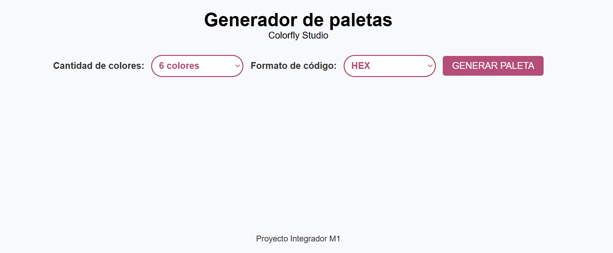

### 2. Estilos y layout
Estilos externos con Flexbox y Grid, foco visible y footer al pie de la página.

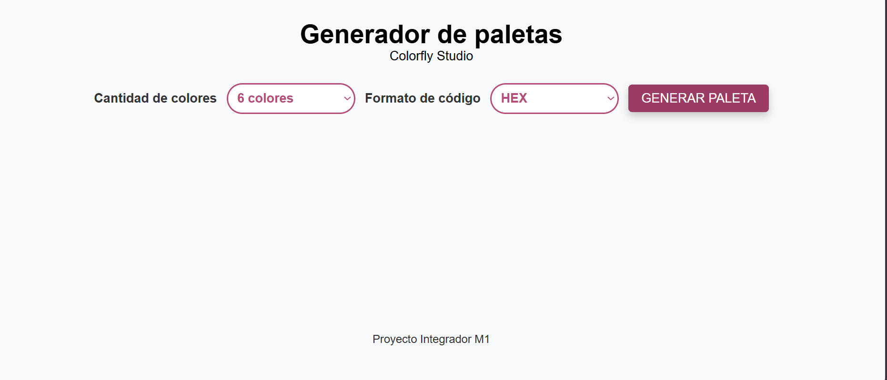

### 3. Generación de colores aleatorios
Funciones que generan colores aleatorios, probadas en la Console de DevTools.

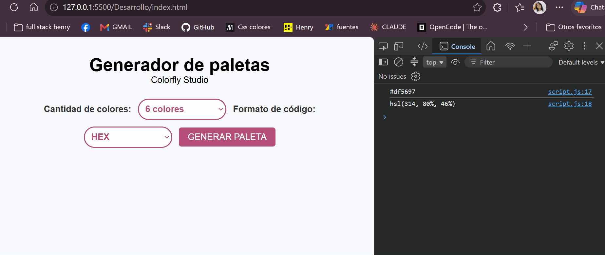

### 4. Evento del botón
Conexión del botón "Generar paleta" con `addEventListener`.

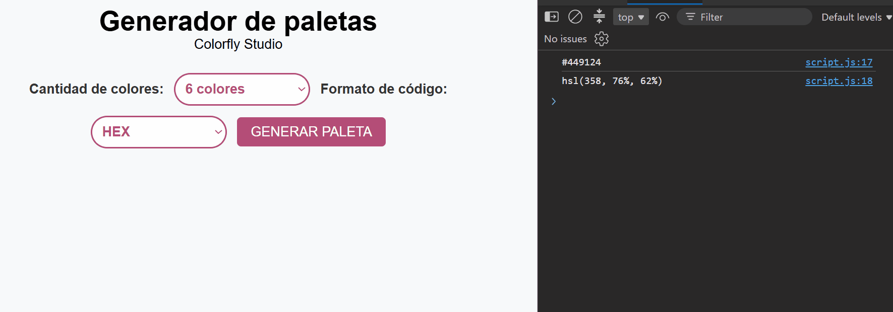

### 5. Render dinámico según el tamaño
La paleta se dibuja con 6, 8 o 9 colores, cada uno con su código visible, y aparece una paleta inicial al cargar la página.

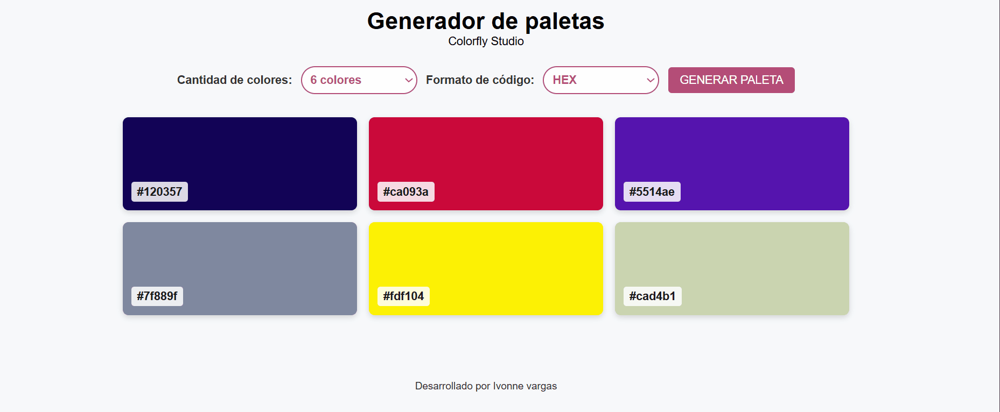

### 6. Microfeedback (toast)
Mensaje breve que confirma cada acción y desaparece solo.

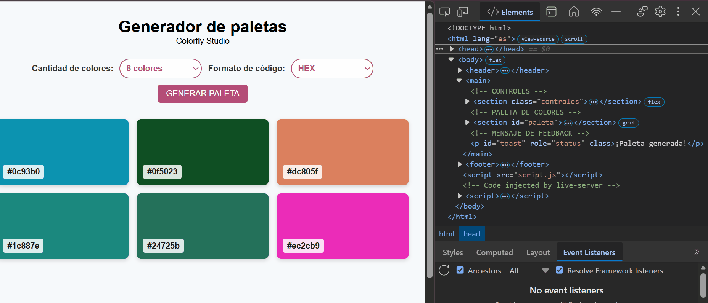

### 7. Cambio de formato sin perder la paleta
Cada color se guarda como números (tono, saturación y luminosidad) y se convierte a HEX o HSL solo para mostrar el código.

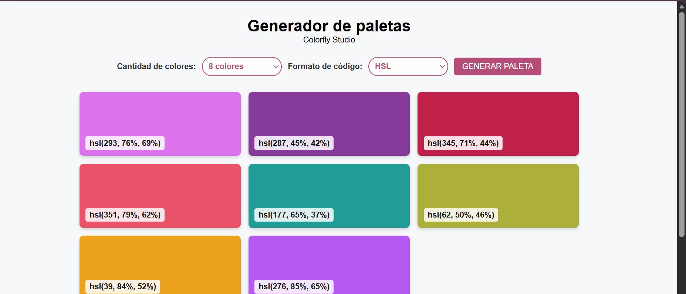

### 8. Copiar el código al portapapeles
Al hacer clic en el código de un color se copia el texto y aparece el toast.

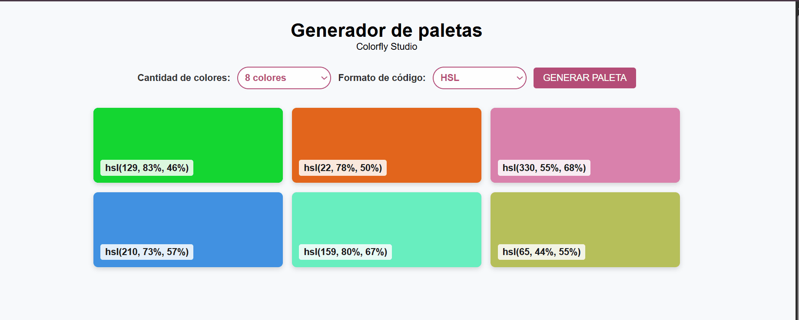

### 9. Anclar un color
El color anclado se conserva y los demás se generan como una gama de colores armónica.

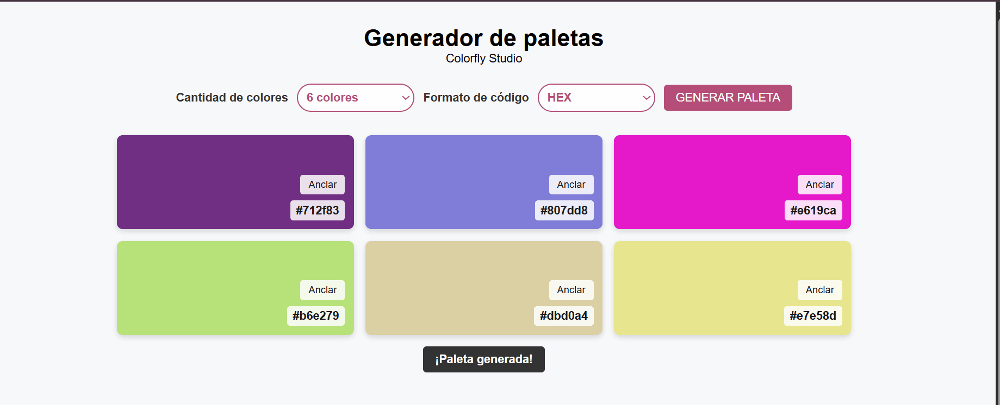

### 10. Historial de paletas con localStorage
Las paletas guardadas siguen disponibles al recargar la página (se guardan en LocalStorage) y se pueden cargar o eliminar.

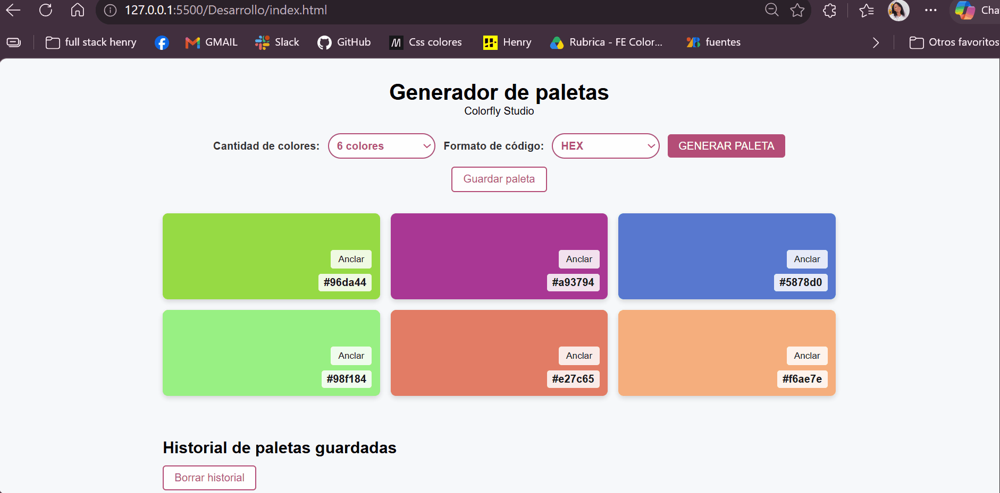

### 11. Diseño responsive
Las columnas se ajustan según el ancho de la pantalla.

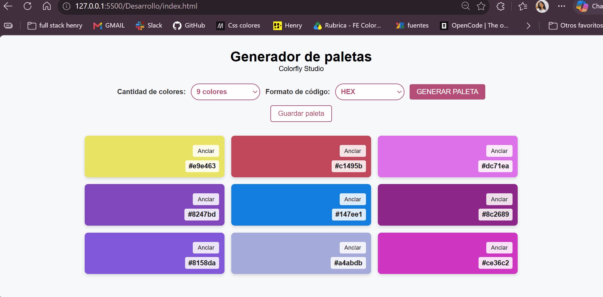

### 12. Instrucciones de uso
Bloque plegable con `
` que explica cómo usar el generador.

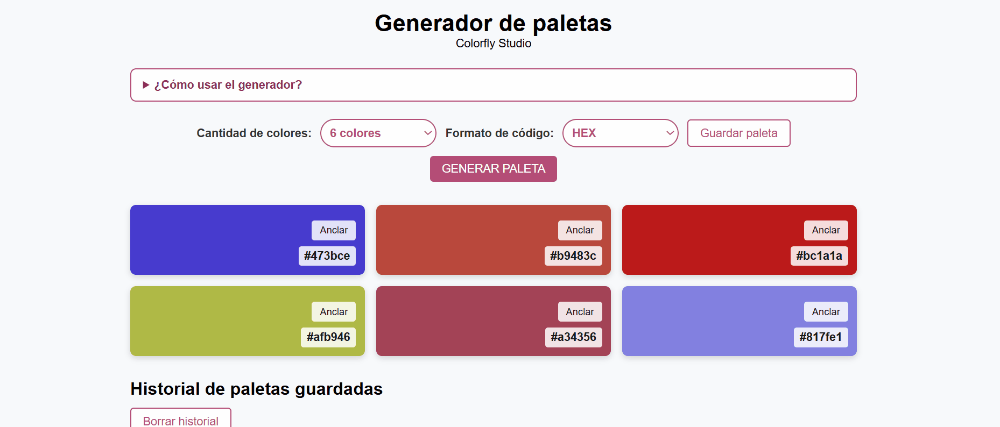

## Uso de DevTools

Usé las DevTools del navegador durante todo el desarrollo, no solo al final:

| Herramienta | Para qué la usé | Evidencia |
|---|---|---|
| **Console** | Probar las funciones de color, verificar el evento del botón y detectar errores de sintaxis | `paso-02-colores-aleatorios.gif`, `paso-03-evento-boton.gif` |
| **Elements** | Ver los `<article>` creados por JavaScript y cómo cambian clases y atributos (`visible`, `data-cantidad`) | `paso-04-render-tamano.gif`, `paso-05-toast.gif` |
| **Elements > Accessibility** | Confirmar que cada `label` queda asociado a su `select` y que el código se anuncia como botón | `labels-asociados.png` |
| **Application > Local Storage** | Revisar la clave `historialPaletas` y comprobar que el historial persiste | `paso-09-historial-uso-devtools.gif` |
| **Modo dispositivo** | Probar la app en 1280px, 768px y 360px | `paso-10-responsive.gif` |

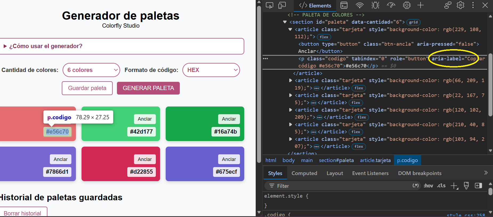

### Errores depurados

- **Coma faltante en `generarColor`:** la Console mostró `Unexpected identifier 'anclado'` con el número de línea. Al agregar la coma, el script volvió a funcionar.
- **Typo en el HTML (`seelect-formato`):** el `id` no coincidía con el `for` del label, por lo que el label quedaba desconectado. Lo corregí al revisar el código.
- **Paleta inicial que desapareció:** al reemplazar el `addEventListener` se borró la llamada `generarPaleta()` del final del script. La Console no mostraba error, así que revisé el orden del código y la restauré.

Recorrido final de la revisión:

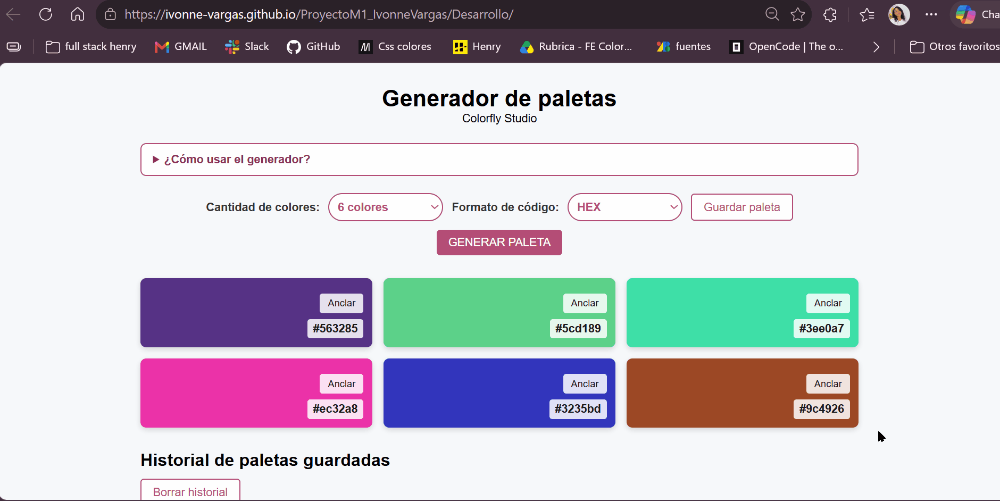

## Pruebas realizadas

Las pruebas se hicieron sobre la demo publicada en GitHub Pages.

| Prueba | Resultado esperado | Resultado |
|---|---|---|
| Recargar la página | Paleta inicial de 6 colores en HEX, sin toast | ✅ Correcto |
| Generar con 6, 8 y 9 colores | Aparece esa cantidad de tarjetas | ✅ Correcto |
| Cambiar entre HEX y HSL | Los colores no cambian, solo el texto | ✅ Correcto |
| Clic en un código | Copia el texto y muestra "Texto copiado" | ✅ Correcto |
| Anclar un color y generar | El anclado se conserva y los demás tienen tono parecido | ✅ Correcto |
| Guardar paleta | Aparece en el historial | ✅ Correcto |
| Recargar con historial guardado | Las paletas siguen ahí | ✅ Correcto |
| Cargar y eliminar del historial | Funcionan y muestran toast | ✅ Correcto |
| Navegar con la tecla Tab | Todos los elementos interactivos muestran foco visible | ✅ Correcto |
| Anchos 1280px, 768px y 360px | Sin scroll horizontal ni elementos rotos | ✅ Correcto |
| Toast con scroll | Se ve arriba sin importar el scroll | ✅ Correcto |
| Console | Sin errores en rojo | ✅ Correcto |

## Documentación del uso de IA

Los prompts, resultados y aprendizajes están en [Documentacion/uso-de-ia.md](Documentacion/uso-de-ia.md).

## Mejoras futuras

- Anclar varios colores a la vez, exportar la paleta como imagen o CSS.

## Autora

Ivonne Vargas · [LinkedIn](https://www.linkedin.com/in/ivonne-alexandra-vargas-1b70a9388) · [GitHub](https://github.com/ivonne-vargas)